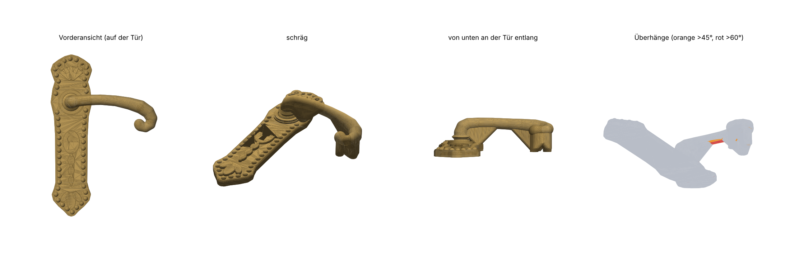
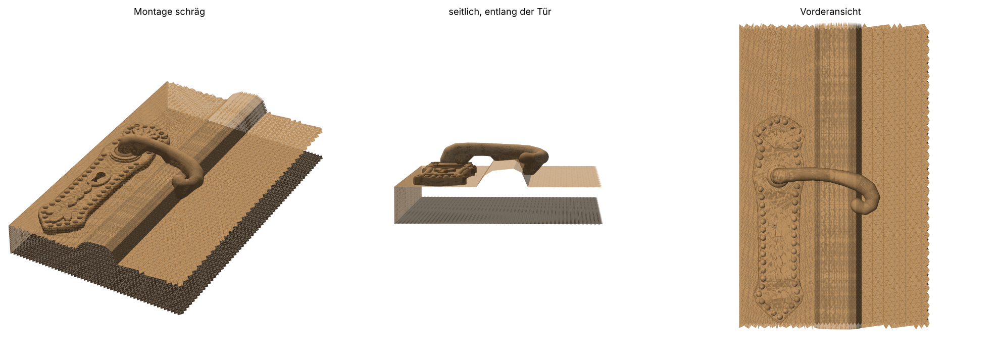
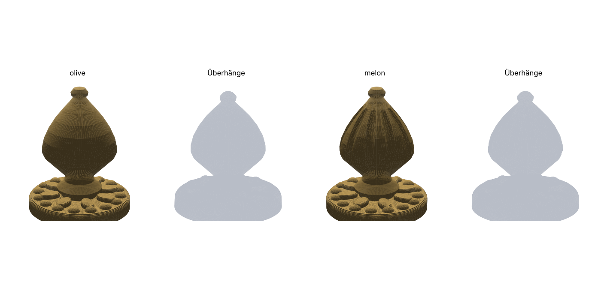

# Türklinke Louis XV für Wand- und Türpaneele

Status: v2 (niedriger Hebel, konforme Montage, Türknäufe), ungedruckt



## Ziel

Eine dekorative Drückergarnitur mit Langschild, passend zu den Boiserie-Paneelen aus dem Slicer-Projekt des Nutzers (`reference/01_slicer_paneele_screenshot.png`). Sie wird im Slicer direkt auf ein Türpaneel gesetzt und mit ihm als ein Teil gedruckt. Die Klinke ist Deko und nicht beweglich.

**Stil:** Die Paneele haben Akanthus-Kartuschen, C-Voluten und Perlstäbe (Régence / Louis XV). Die Klinke greift das auf:

- Langschild mit geschweiftem Umriss: Fußspitze, unterer Lappen, Taille und Ohren oben
- Perlstab-Rand wie an den Paneelen
- Muschelfächer mit C-Voluten oben, Glockenblumen-Gehänge unter dem Schlüsselloch, Akanthus-Tropfen unten
- Rosette mit Perlring und Kuppel am Hebel
- Hebel „bec de cane“, leicht geschwungen, mit nach unten eingerollter Volute und Knauf

## Maße (gemessen / angenommen)

| Parameter | Wert | Quelle |
|---|---|---|
| Türpaneel im Slicer | ≈ 65 × 150 mm | **ANGENOMMEN**, aus dem Screenshot über das 10-mm-Raster von Bambu Studio geschätzt, ±7 % (Perspektive) |
| Maßstab | ≈ 1:13,3 (150 mm ↔ 2 m Tür) | abgeleitet |
| Vorbild real | Langschild 290 × 74 mm, Drücker 145 mm, Ausladung 66 mm, Entfernung Drücker–Schlüssel 72 mm (DIN 18251 Zimmertür) | übliche Werte, nicht gemessen |
| Modell | Schild 5,6 × 22 mm × 0,8 mm, Hebel 11,5 mm ab Achse, Ausladung 5,75 mm, Schlüsselloch 5,4 mm unter der Achse | `out/tuerklinke_louis_report.json` |
| Gesamt (freistehend, v2) | 14,3 × 22,0 × 4,15 mm, 0,2 g, Hebelachse 3,4 mm (v1: 5,0) | |
| Paneel ohne Tür | 3,6 mm | Angabe Nutzer, als Höhe der flachen Paneelfläche (Fries) interpretiert |

Mit `--door-panel-h <mm>` (tatsächliche Paneelhöhe aus dem Slicer) oder `--size` skaliert alles gleichmäßig. Das ist das Gleiche wie gleichmäßiges Skalieren im Slicer.

## Druckbarkeit

- **Orientierung:** wie die Paneele liegend, z = 0 ist die Türoberfläche. Schild, Ornamente und Knäufe sind reines Aufwärts-Relief.
- **Hebel (v2):** Er schwebt über der Tür und braucht deshalb einen senkrechten **Steg**.
  - Breite: 1,41 × Hebelradius, ≥ 1 mm. So trifft der Steg den runden Hebel an dessen 45°-Punkten.
  - Der Steg wird gelöst statt fest gezeichnet (`mount.solve_web`, entlang des Hebelwegs):
    - **Stützpunkte** sind der Hals, jede Stelle, an der der Hebel ohnehin aufliegt (Abstand ≤ 0,45 mm), und zusätzliche Stellen. Zusätzliche kommen hinzu, bis jede freie Strecke unter dem Hebel eine **Brücke ≤ 3 mm** ist und das freie Ende höchstens 0,6 mm auskragt.
    - Zwischen den Stützpunkten ist der Steg ein **Spitzbogen mit 45°-Flanken**. Jede Schicht wächst also höchstens 1:1 über die darunter, das bleibt stützfrei.
  - Freistehend (flache Tür): 5 Stützpunkte, 17,6 mm² Stegfläche, Endpfosten 2,2 mm, längste Brücke 2,2 mm.
  - Gemeldeter „Überhang“ 2,9 mm²: Das ist die Hebelunterseite über diesen Brücken.
- **Kleinste Details** werden geprüft (`details_ok`, Abbruch bei Unterschreitung):

  | Detail | Maß |
  |---|---|
  | Steg | ≥ 0,99 mm |
  | Hebel | ≥ Ø 1,04 mm |
  | Perlen | Ø 0,66 mm |
  | Schlüsselloch-Schlitz | 0,52 mm |
  | Schild | 0,8 mm |
  | Brücken | ≤ 3 mm |

  - Bei 0,4-mm-Düse **nicht unter ≈ 90 % skalieren**.
  - Perlen und Muschelrippen werden mit 0,4 mm eher Textur, mit 0,2-mm-Düse feiner.
- **Empfehlung:** 0,08–0,12 mm Schichthöhe oder variable Schichthöhe.

## Klinkenmontage optimieren: Hebel auf die Rahmenleiste legen (`--panel-stl`)



**Problem v1** (Screenshot des Nutzers): Auf dem Paneel wirkte der Hebel wie ein Henkel. Er stand hoch (Achse 5 mm), und unter der Volute stand ein voller Pfosten bis hinunter auf das Fries.

**Lösung v2: konforme Montage.** Der Generator liest das Paneel-STL ein, rastert dessen Oberfläche (z-Puffer, 0,05 mm, `mount.HeightMap`) und arbeitet in fünf Schritten:

1. **Schild:** Es setzt auf der echten Friesoberfläche auf, am 98-%-Wert unter der Schildfläche. Ist die Fläche uneben, wird darunter aufgefüllt.
2. **Hebel so tief wie möglich:** Die Achse liegt mindestens 2,6 mm über dem Schild, das ist das Minimum, damit der Hals über die Rosettenkuppel kommt. Gleichzeitig muss der Hebel über dem Rahmenprofil liegen. Er sinkt 0,1 mm ein und wird von der Leiste **getragen**.
3. **Steg:** Er wird gegen die echte Oberfläche gelöst. Auf der Leiste ist kaum Steg nötig, zwischen Schild und Leiste spannt eine kurze Brücke.
4. **Hebellänge** (`--lever-len 0`): Der gerade Arm wird zwischen 0,8 und 1,2 gestreckt. Gewählt wird die Länge mit der kleinsten Stegfläche und dem kürzesten Endpfosten, so endet die Volute auf der Leiste.
5. **Ausgabe:**
   - `tuerklinke_louis_<hand>_montiert.stl`: die Klinke in Paneel-Koordinaten
   - `panel_mit_klinke_<hand>.stl`: Paneel und Klinke als eine Datei, die das Paneel-Objekt im Slicer ersetzt

**Testpaneel** (`--panel-stl demo`, synthetisch): Platte 3,6 mm, Kehlleiste 1,8 mm hoch bei x = 8–13 mm, Klinke bei (4,2 | 38).

| | v1-Logik (Achse fest) | v2 auf der Leiste |
|---|---|---|
| Hebelachse über Fries | 3,4 mm (v1: 5,0) | **2,73 mm** |
| Hebelstreckung | 1,0 | 0,9 (automatisch) |
| Endpfosten unter der Volute | 2,24 mm | **0,29 mm** |
| Stegfläche | 17,6 mm² | **4,7 mm²** |
| längste Brücke | 2,2 mm | 2,1 mm |

```bash
python3 projects/tuerklinke-louis/generate.py --panel-stl pfad/paneel.stl --at 12.5,61 --lever-len 0 --hand rechts
#   --at x,y   = Position der Hebelachse in den Koordinaten des Paneel-STL (mm)
#   --angle    = Hebelrichtung in Grad (0 = +x), --knob-at x,y = Knauf auf dasselbe Paneel
```

**Vorbehalt:** Getestet nur am synthetischen Paneel. Ob die Koordinaten des Paneel-STL im Slicer erhalten bleiben, hängt vom Export ab. Darum gibt es die kombinierte Datei `panel_mit_klinke_*.stl`: Sie ersetzt das Paneel-Objekt komplett, und nichts muss positioniert werden.

## Royale Türknäufe (`tuerknauf_olive`, `tuerknauf_melon`)



Für die eher wandtauglichen Paneele: Knauf auf Rosette in der klassischen Ogiv-Form, gewollt „Plug-artig“.

- **Form:** schmaler Hals Ø 1,44 mm, Bauch weitet sich mit genau 45° auf Ø 3,9 mm, spitz zulaufende Kuppel mit Knopf-Finial.
- **Rosette:** Ø 5,4 mm mit Perlstab (16 Perlen à Ø 0,66) und Blattkranz.
- **melon:** zusätzlich 10 Kanneluren vom Bauch bis zur Spitze, wie bei vergoldeten Louis-XV-Knäufen.
- Ausladung 6,6 mm. Das entspricht real ≈ 88 mm, ist also kräftiger als ein echter Knauf (≈ 65 mm): bewusst „royal“.
- **Druck:** stehend, 0 mm² Überhang, Bauchunterseite 45° (`bulb_underside_deg`, Assert).
- Mit `--panel-stl … --knob-at x,y` wird der Knauf auf die Paneeloberfläche gesetzt (`tuerknauf_<v>_montiert.stl`).

## Im Slicer platzieren (Bambu Studio)

1. Paneel-Objekt rechtsklicken → **Teil hinzufügen → Laden** → `tuerklinke_louis_rechts.stl` oder `_links.stl`.
   - Als Teil desselben Objekts werden Klinke und Paneel als ein Körper verschmolzen gedruckt.
   - Ich habe nicht geprüft, wo Bambu Studio ein hinzugefügtes Teil in z ablegt.
2. **z-Position** auf die Höhe der Paneeloberfläche setzen, **minus 0,2 mm**. Bei der flachen Fläche von 3,6 mm also **z = 3,4 mm**. Das gilt, wenn 3,6 mm die Höhe der Friesfläche ist und nicht die Gesamthöhe mit Profil.
   - Besser: die konforme Montage oben, dann entfällt das Positionieren.
3. **Lage auf der Tür:**
   - Höhe: Drückerachse etwa 79 mm über der Paneel-Unterkante. Real sind das 1 050 mm.
   - Waagerecht: Schild mittig zwischen dem Perlstab am Rand und der inneren Profilleiste, dort ist laut Screenshot ≈ 7 mm Platz.
   - Der Hebel zeigt zur Türmitte und darf über die Profilleiste ragen, der Steg verschmilzt dann mit ihr.
4. **rechts** = Hebel zeigt nach rechts, also für das linke Türfries (Band rechts). **links** ist gespiegelt.

## Dateien (`out/`)

| Datei | Inhalt |
|---|---|
| `tuerklinke_louis_rechts.stl` / `.3mf` | Hebel nach rechts (+x) |
| `tuerklinke_louis_links.stl` / `.3mf` | gespiegelt |
| `tuerknauf_olive.stl` / `tuerknauf_melon.stl` | Türknäufe |
| `tuerklinke_louis_montage.png` | Montage-Demo am Testpaneel |
| `tuerklinke_louis_probe.3mf` | beide Klinken auf einem 40 × 30 × 1,2-mm-Probeblock, kurzer Testdruck für Größe und Detail (Druckzeit nicht ermittelt) |
| `tuerklinke_louis_report.json` | Maße, Detailprüfung, Druckbarkeitsberichte |

```bash
python3 projects/tuerklinke-louis/generate.py                         # Standard (Paneel 150 mm)
python3 projects/tuerklinke-louis/generate.py --door-panel-h 162      # an die echte Paneelhöhe anpassen
python3 projects/tuerklinke-louis/preview.py                          # Übersichtsbild
```

## Offene Fragen

- **Paneel-STL** der Tür und der Wandpaneele aus dem Slicer-Projekt: Damit läuft die konforme Montage auf der echten Geometrie statt auf dem Testpaneel.

- Exakte Höhe des Türpaneels im Slicer (Objektmaße in Bambu Studio)? Die Klinke ist ein Schätzwert ±7 %.
- Welches Paneel ist die Tür, und auf welcher Seite sitzt das Band? Daraus folgt links oder rechts.
- Soll sie farblich abgesetzt werden (Messing/Gold)? Dann wäre ein Filamentwechsel über die z-Höhe oder ein AMS-Farbwechsel sinnvoll. Falls ein AMS lite vorhanden ist, ginge das als Teil mit eigener Farbe.
